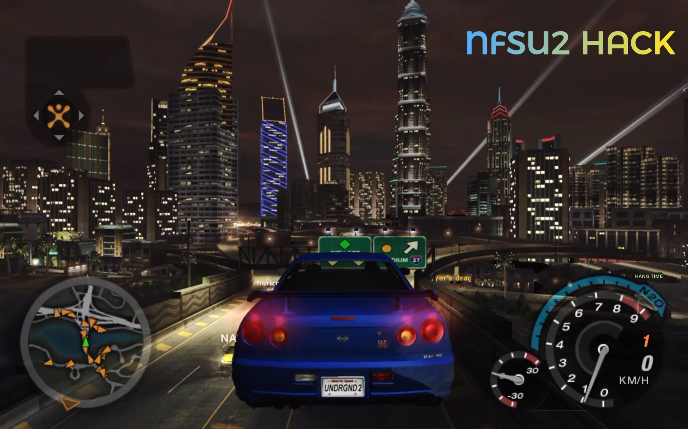

# NFSU2 WebAssembly Trainer / NOS Hack

> A lightweight, feature-rich memory manipulation script and trainer designed for **nfsu2.xyz**. Features custom NOS acceleration, position save/load, jump mechanics, drift assist, low gravity, spin, and a built-in HUD overlay!

---

## Quick Links & References

- **Target Platform:** Play the game directly at [nfsu2.xyz](https://nfsu2.xyz)
- **Video Demonstration:** [Watch on YouTube](https://youtu.be/c2urRNPexhU)

---

## Features

- **Custom NOS Boost:** Dynamic acceleration control with adjustable km/h increments (50 - 500 km/h).
- **Position Save & Load:** Coordinate persistence allowing instant state saving and telemetry restoration.
- **Stop Lock / Hard Stop:** Instant vehicle immobilization and position locking mechanisms.
- **Jump Mechanic:** Upward velocity vector application for obstacle clearance, with adjustable jump power (6 - 60).
- **Drift Assist:** Uses the game's own drift handling. In free roam, **X** remains the game's drift toggle; outside free roam (races, outruns, events) the trainer forces drift on. Keeps the streak alive through wall hits, and every 1,000,000 points are banked automatically so the counter restarts.
- **Low Gravity:** Softens falls and keeps the car in the air longer.
- **Spin:** Holds the car at its current position and continuously rotates it around the world's vertical axis, so it spins in place instead of sliding or launching.
- **Rebindable Hotkeys:** Click any key badge in the panel and press a new key. The binding is saved in the browser; a key already in use swaps with the old one, and **RESET KEY BINDINGS** restores the defaults. Defaults avoid the game's **1-4** quick-chat keys, and the panel key itself can be moved off **Insert** for laptops.
- **On-Screen Panel:** A compact, draggable trainer window at the top-left with labeled rows, state indicators, and sliders. Toggle with **Insert** (rebindable); a small **☰ TRAINER** tab brings it back when hidden, and the whole panel works with a mouse or touchpad only.
- **Controller & Keyboard Support:** Dual input handling for standard keyboard layouts and XInput-compatible Gamepads.
- **Clean HUD Overlay:** Native HTML Popover API implementation ensuring zero external CSS dependencies.
- **Works on old and new game builds:** Detects both the pre- and post-2026-11-03 player address, so the trainer keeps working after the split-screen update.

---

## Controls

### Keyboard (Digit Row / Numpad)

| Key | Action |
| :---: | :--- |
| **5** | Toggle Boost ON/OFF |
| **6** | Jump |
| **7** | Stop Once (Hard Stop) |
| **8** | Toggle Stop Lock ON/OFF |
| **9** | Save Position |
| **0** | Load Position |
| **- / =** | Decrease / Increase Boost Power (-/+ 50 km/h; **Num - / Num +** also work) |
| **, / .** | Decrease / Increase Jump Power |
| **Z** | Toggle Spin |
| **K** | Show / Hide Help HUD |
| **Insert** | Show / Hide On-Screen Panel (rebindable) |
| **Alt (Hold)** | Keep NOS active |

> These are only the defaults. Click a key badge in the panel to rebind any action (for example, set **HARD STOP** to **Z**); the old key is swapped to the action that had the new one. Bindings persist in the browser. **P** (pause), **Esc** and **F9** are reserved.

> **Laptop without Insert?** Click the **☰ TRAINER** tab to open the panel, then click the **TRAINER PANEL** key badge and press an easy key (for example **L**). The new key opens and closes the panel from then on.

> **X** is the game's own drift toggle in free roam. Outside free roam the trainer intercepts **X** and toggles **FORCE DRIFT** instead, so the game's "Drift mode only works in free roam" message does not appear. The panel's **FORCE DRIFT** row and gamepad **B** do the same.

### Gamepad Layout

| Button | Action |
| :---: | :--- |
| **LB** | Toggle Boost |
| **RB** | Jump |
| **A** | Toggle Stop Lock |
| **B** | Toggle Force Drift |
| **X** | Toggle Low Gravity |
| **Y** | Toggle Spin |
| **D-Pad Left / Right** | Save / Load Position |
| **D-Pad Up / Down** | Boost Power +/- |

### On-Screen Panel

The panel starts hidden as a small **☰ TRAINER** tab at the top-left. Click the tab or press **Insert** to open it. Drag the window by its header to move it, and use the **–** button or the panel key to hide it again. It has state indicators, clickable sliders with **− / +** step buttons, and a key badge for every action, so it is fully usable with only a mouse or touchpad. It does not use **P** (the game's pause key) or **F9**.

---

## Usage Instructions

1. Navigate to [nfsu2.xyz](https://nfsu2.xyz) via a WebAssembly-compatible browser.
2. Open the Developer Console (`F12` or `Ctrl+Shift+I`).
3. **Inject the contents of `trainer.js` before pressing Play.** The trainer hooks `WebAssembly.Memory`, and the game's memory must be created after the hook is in place.
4. Press **Play**. A small **☰ TRAINER** tab appears at the top-left; click it (or press **Insert**) to open the panel.
5. Use **Z** for spin. In free roam, press **X** for the game's own drift setup; in races and other modes, **X** toggles the trainer's force drift. Click any key badge to rebind it; on a laptop, rebind **TRAINER PANEL** away from **Insert**.

### Troubleshooting

- **~1 second freeze the first time NOS kicks in:** the game is loading the NOS effect and streaming map assets at high speed. It is not a trainer bug. Lower the boost power with **-** if it bothers you.
- **Trainer does nothing:** it was injected after the game started. Reload the page and inject it again before pressing Play.
- **Drift mode feels too slippery in races:** press the panel's **FORCE DRIFT** row or gamepad **B** to turn it off. In free roam, **X** still toggles the game's own drift.
- **Pressing X in a race still shows "Drift mode only works in free roam":** an older `trainer.js` is loaded. Reload the page, inject this build before **Play**, and the trainer stops **X** before the game's input sees it.
- **No Insert key / panel will not open on a laptop:** click the **☰ TRAINER** tab at the top-left. Then click the **TRAINER PANEL** key badge and press an easy key such as **L**; that key opens and closes the panel from then on.
- **The 1-4 quick-chat picker is not from the trainer:** it is part of nfsu2.xyz's free-roam multiplayer, and the trainer's defaults deliberately avoid **1-4**. To remove it completely, open **Settings > Online > Quick chat** and turn it off; the game then neither shows nor sends phrases.

---

## Changelog

### v1.1

- **Fixed for the 2026-11-03 split-screen update.** The web build moved `PlayersByNumber[0]` from `0x008900AC` to `0x00D00000`. The trainer now detects either address and sanity-checks the pointer chain, so it works on both old and new builds.
- **Drift Assist in every mode.** In free roam, **X** stays the game's own drift toggle. Outside free roam the trainer intercepts **X** before the game's input sees it and forces the game's drift-event switch on, so races use the drift handling without the "Drift mode only works in free roam" message. The trainer now finds the player's own racer in the position-sorted race list, keeps the pending streak through wall hits, and banks 1,000,000 points at a time. Gamepad **B** and the panel row toggle the force.
- **Rewrote Spin.** The car is held at its current position and continuously rotated around the world's vertical axis, so it spins in place instead of sliding, orbiting or launching.
- **No stale drift in free roam.** After a race with FORCE DRIFT on, returning to free roam restores the game's own drift toggle instead of leaving the forced switch on.
- **Rebindable hotkeys.** Click any key badge in the panel, press a new key, and the binding is saved. A key already in use swaps with the old one, and **RESET KEY BINDINGS** restores the defaults. Defaults moved off **1-4**, which are the game's free-roam quick-chat keys, and the panel key can be rebound away from **Insert** for laptops.
- **Rebuilt the panel as a real trainer window.** Compact top-left layout that fits small laptop screens, a draggable header, labeled rows with ON/OFF states, grouped sections, and a top-layer **☰ TRAINER** tab when hidden. Toggle with **Insert** or the tab; **P** (pause) and **F9** are left to the game.
- **Removed the trainer speedometer.** The game already has one, and the extra readout only cluttered the screen.
- **Removed the trainer's G shortcut** for low gravity, because **G** toggles the game's headlights. Low gravity remains available from the panel and gamepad **X**.
- **Typing guard:** trainer hotkeys no longer fire while the game's text entry or a focused text field is open, so online chat stays usable.
- Adjustable jump power and gamepad bindings for force drift, spin, low gravity, save/load, and boost power.

### v1.0

- Initial public release: NOS boost, position save/load, stop lock, jump, HUD

---

## Disclaimer

This software is provided strictly for educational and research purposes, demonstrating WebAssembly memory hooks and runtime manipulation concepts within browser environments.

---

## License

Distributed under the MIT License. See `LICENSE` for details.

## Credits
- Background Music: Music by [Marco Conti](https://pixabay.com/users/velariomusic-54515099/) from [Pixabay](https://pixabay.com/music/)
