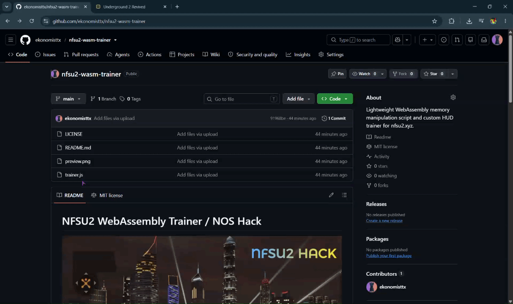

# NFSU2 WebAssembly Trainer

Trainer for **nfsu2.xyz**. It hooks `WebAssembly.Memory` before the game starts and changes the game's memory from the browser console.

---

## Links

- **Game:** [nfsu2.xyz](https://nfsu2.xyz)
- **Video:** [Watch on YouTube](https://youtu.be/c2urRNPexhU)

---

## Features

- **NOS boost:** raises the car's speed towards a target. The target is the speed when boost was enabled plus 50-500 km/h, adjustable.
- **Jump:** adds upward velocity. Power is adjustable from 6 to 60.
- **Hard stop / stop lock:** zeroes the car's velocity. Stop lock also holds the position and orientation; it uses a deadband and pins the render body so the camera does not shake.
- **Position save / load:** stores the position, centre of mass and orientation, plus the game's own copies of them, and restores them for 250 ms.
- **Drift:** the game's own **X** toggle in free roam. The trainer keeps the pending streak through wall hits and banks 1,000,000 points at a time. It does not force the drift switch in races or outruns; the game's style-points branch then uses a stale pointer and the WASM build crashes.
- **Low gravity:** reduces downward velocity while falling.
- **Spin:** holds the car at its current position and turns it around the world's vertical axis.
- **Barrel roll:** holds the car at its current position and turns it around its own forward axis. It can run together with spin. Turning it off puts the car back on its wheels, so the camera does not stay tilted.
- **Showoff:** turns on the game's hydraulics and alternates **H** and **J**, writes tyre slip for the game's smoke effect, pulses the nitrous state for exhaust flames, and cycles the game's own **O** hood/trunk/door showoff while parked in free roam. Hydraulics and the **O** parts need free roam and low speed; the smoke and flames also work outside it.
- **Career:** shows the bank and adds $100,000 or $1,000,000. It can open the five base garage slots and set the 32 bonus-part/cover-shoot flags. These buttons work only in career mode.
- **Rebindable keys:** click a key badge in the panel and press a new key. Bindings are saved in the browser. A key already in use is swapped, and **RESET KEY BINDINGS** restores the defaults. The defaults avoid the game's **1-4** quick-chat keys.
- **Panel:** compact window at the top-left, hidden by default. Open it with the **☰ TRAINER** tab or the panel key (**Insert** by default). Drag it by the header.
- **Typing guard:** trainer keys do not fire while the game's text entry or a focused text field is open.
- **Both player addresses:** works with the old `0x008900AC` player base and the post-2026-11-03 `0x00D00000` base.

---

## Controls

### Keyboard

| Key | Action |
| :---: | :--- |
| **5** | Toggle NOS boost |
| **6** | Jump |
| **7** | Hard stop |
| **8** | Toggle stop lock |
| **9** | Save position |
| **0** | Load position |
| **- / =** | Boost power -/+ 50 km/h (**Num - / Num +** also work) |
| **, / .** | Jump power -/+ |
| **Z** | Toggle spin |
| **U** | Toggle barrel roll |
| **Y** | Toggle showoff |
| **K** | Show/hide help |
| **Insert** | Show/hide panel |
| **Alt (hold)** | Keep NOS active |

These are the defaults. Click a key badge in the panel to rebind any action. Bindings persist in the browser. **P** (pause), **Esc** and **F9** are reserved.

**No Insert key?** Click the **☰ TRAINER** tab, click the **TRAINER PANEL** key badge, and press another key.

**X** is the game's drift toggle in free roam. Outside free roam the trainer swallows **X** so the game does not show its "Drift mode only works in free roam" message. The trainer does not force drift in races.

### Gamepad

| Button | Action |
| :---: | :--- |
| **LB** | Toggle boost |
| **RB** | Jump |
| **A** | Toggle stop lock |
| **X** | Toggle low gravity |
| **Y** | Toggle spin |
| **D-Pad Left / Right** | Save / load position |
| **D-Pad Up / Down** | Boost power +/- |

Barrel roll, showoff and career are on the panel; they have no default gamepad button.

### Panel

The panel starts hidden as a **☰ TRAINER** tab. Click the tab or press **Insert** to open it. The **–** button or the panel key hides it again. Sliders have **− / +** buttons, so the trainer can be used with a mouse or touchpad only.

---

## Usage

1. Open [nfsu2.xyz](https://nfsu2.xyz) in a browser that supports WebAssembly.
2. Open the developer console.
3. Paste the contents of `trainer.js` **before pressing Play**. The trainer hooks `WebAssembly.Memory`; the game's memory must be created after the hook.
4. Press **Play**. The **☰ TRAINER** tab appears at the top-left.
5. Click the tab or press **Insert** to open the panel.

### Install clip

The clip shows the install: open nfsu2.xyz, press **F12**, paste `trainer.js` into the console, then press **Play**.

### Showoff

Stop the car in free roam, open the panel, and click **SHOWOFF**. The trainer enables hydraulics for the current car, alternates **H** and **J**, writes tyre slip for smoke, pulses the exhaust flame, and presses **O** to cycle the hood, trunk and doors. Toggle it off to restore the fields it changed. If the car is moving faster than about 10 mph, the hydraulic keys are not sent.

### Career

Open the panel in career mode. **ADD $100,000** and **ADD $1,000,000** write the career bank. **UNLOCK 5 BASE GARAGE SLOTS** clears the locked flag on the five slots the base game owns. **UNLOCK BONUS PARTS** sets the 32 flags for the unique parts and cover shoots. Use these in the garage or career menus, not during a race or save. The trainer does not touch the game's extra slots 6-10, because the web port keeps those outside the base career structure.

---

## Troubleshooting

- **About 1 second freeze the first time NOS kicks in:** the game is loading the NOS effect and streaming map assets. Lower the boost power with **-** if it bothers you.
- **Trainer does nothing:** it was injected after the game started. Reload the page and inject it again before pressing Play.
- **Drift mode in races:** drift is free roam only. The trainer does not force it in races because that crashes the game's WASM build.
- **Pressing X in a race still shows the drift message:** an older `trainer.js` is loaded. Reload the page and inject this build before Play.
- **No Insert key / panel will not open:** click the **☰ TRAINER** tab, then rebind **TRAINER PANEL** to another key.
- **The 1-4 quick-chat picker is not from the trainer:** it belongs to nfsu2.xyz. The trainer's defaults avoid **1-4**. It can be turned off in the site's Settings, Online, Quick chat.
- **Stop lock still shakes:** report the car and location. The current build pins the render body and uses a 5 mm position deadband; a different camera path may need another field.

### Can the trainer hide my name or IP, or prevent a ban?

No. The trainer runs in your browser and only changes the game's local memory. The server still receives your account, name and IP. Bans on nfsu2.xyz are manual, and they can cover a network or VPN, not just one account. A client-side mode cannot hide that. Use a separate account and network if you accept the risk, or do not use the trainer around other players.

---

## Changelog

### v1.1

- **Fixed for the 2026-11-03 split-screen update.** The web build moved `PlayersByNumber[0]` from `0x008900AC` to `0x00D00000`. The trainer detects either address and checks the pointer chain.
- **Drift stays in free roam.** **X** is the game's own toggle. The trainer keeps the pending streak through wall hits and banks 1,000,000 points at a time. Outside free roam, **X** is swallowed so the game does not show its drift message. Forcing the switch in a race makes the style-points branch use a stale pointer and crash.
- **Stop lock no longer shakes the camera.** It uses a 5 mm position deadband, a 0.8-degree orientation deadband, and pins the render body's position and orientation.
- **Spin and barrel roll share one held pose.** Spin turns around the world's vertical axis; barrel roll turns around the car's forward axis. With both on, spin is applied first and the roll follows the new forward axis.
- **Showoff added.** It uses the game's hydraulics, slip-based tyre smoke, nitrous flame and hood/trunk/door showoff.
- **Career controls added.** Bank display, +$100,000, +$1,000,000, five base garage slots, and the 32 bonus-part/cover-shoot flags.
- **Rebindable hotkeys.** Click any key badge, press a new key, and the binding is saved. A key already in use swaps with the old one. **RESET KEY BINDINGS** restores the defaults. Defaults avoid **1-4**, and the panel key can be moved off **Insert**.
- **Panel rebuilt.** Compact top-left layout, draggable header, ON/OFF states, grouped sections, and the **☰ TRAINER** tab. **P** and **F9** are left to the game.
- **Speedometer removed.** The game already has one.
- **Low gravity moved off G.** **G** toggles the game's headlights; low gravity is on the panel and gamepad **X**.
- **Typing guard.** Trainer keys do not fire while text entry is open.
- Adjustable jump power and gamepad bindings for spin, low gravity, save/load and boost power.

### v1.0

- Initial release: NOS boost, position save/load, stop lock, jump, HUD.

---

## Disclaimer

This software is provided for educational and research purposes, demonstrating WebAssembly memory hooks and runtime manipulation in a browser. Use it at your own risk.

---

## License

MIT. See `LICENSE`.

## Credits

- Background music: Marco Conti, [Pixabay](https://pixabay.com/users/velariomusic-54515099/)
